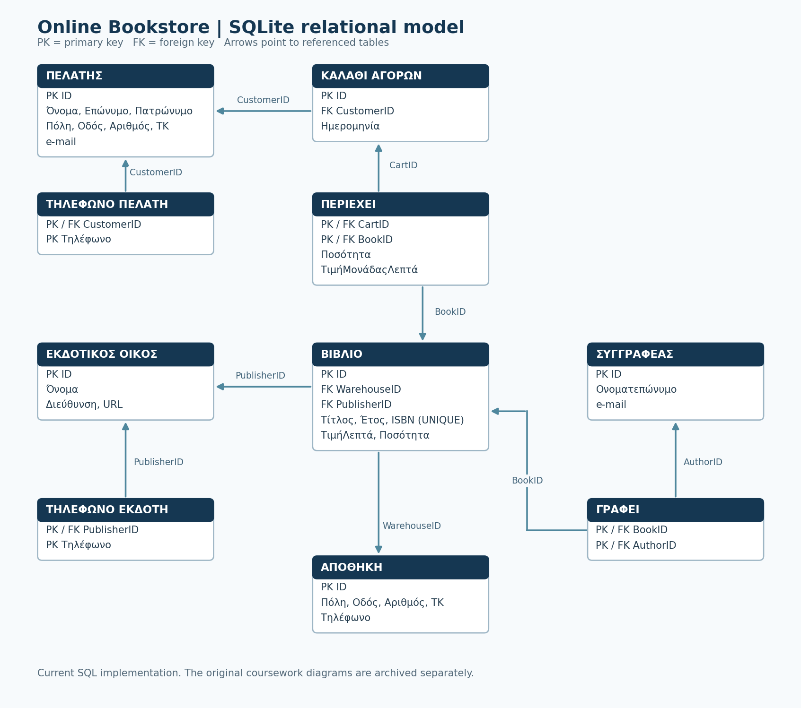

# Online Bookstore Database

Relational database design for an online bookstore, developed as university database coursework in 2024. The model covers customers, books, authors, publishers, warehouses and purchase baskets. 



## Features

- Ten relational tables, with foreign keys, unique identifiers and association keys.
- Many-to-many book authorship and basket contents.
- One publisher and one warehouse per book.
- Separate tables for multiple customer and publisher phone numbers.
- Historical purchase prices, including any discount, stored on basket lines.
- Integer euro-cent prices and validation of quantities and references.
- Seven SQL reports covering catalogue searches, stock totals and purchase statistics.

## Run the demo

Requirements: Python 3.10 or newer with its standard `sqlite3` module. No external Python packages are needed.

From the repository root:

```sh
python3 scripts/demo.py
```

This creates a temporary in-memory database, loads the sample data, validates it and prints all seven query results. On Windows, `python` can be used if that is the installed Python command.

To save a **new** database file:

```sh
python3 scripts/demo.py --database data/bookstore.db
```

The script refuses to overwrite any existing file or initialize a nonempty database. Generated database files are excluded from Git.

### SQLite GUI or command line

In a SQLite database tool, create a new empty database and execute `database/schema.sql`, then `database/seed.sql`. Each file enables foreign keys. Run individual reports from `database/queries/`.

With the optional SQLite command-line tool:

```sh
sqlite3 bookstore.db
```

Inside the SQLite prompt, using a new empty database:

```text
.bail on
PRAGMA foreign_keys = ON;
.read database/schema.sql
.read database/seed.sql
.headers on
.mode column
.read database/queries/05_largest_cart.sql
.quit
```

Enable `PRAGMA foreign_keys = ON` whenever opening a new connection. The Python demo already does this.

## Coursework queries

| Query | Result |
| --- | --- |
| [01](database/queries/01_ieee_books.sql) | IEEE book titles ordered by title |
| [02](database/queries/02_programming_publishers.sql) | Publishers of books starting with `Προγραμματισμός` |
| [03](database/queries/03_paulo_coelho_books.sql) | All book fields for books linked to `Paulo Coelho` |
| [04](database/queries/04_warehouse_stock.sql) | Available copies per warehouse, including empty warehouses |
| [05](database/queries/05_largest_cart.sql) | Customer and total of the largest individual basket, including ties |
| [06](database/queries/06_most_prolific_authors.sql) | Authors with the most books, including ties |
| [07](database/queries/07_books_with_six_customers.sql) | Books bought by more than five distinct customers |

Sample results include 31 copies in warehouse 1, 38 in warehouse 2 and 0 in warehouse 3. Basket 8 is worth 21,000 cents (€210.00). Book 1 has six distinct buyers even though one buyer has purchased it more than once.

All personal records, purchases and book fixtures are fictional. `IEEE` and `Paulo Coelho` are labels used to exercise the assignment queries; the demo does not represent their real publications or authorship. The `DEMO-ISBN-*` values are placeholders, and contact addresses use `example.invalid`.

## Tests

```sh
python3 -m unittest discover -s tests -v
```

The 27 tests check all seven reports, ties, repeated buyers, empty warehouses, historical prices, foreign keys, unique keys, invalid numeric values, date validation and safe database initialization. 

## Repository structure

| Path | Contents |
| --- | --- |
| `database/schema.sql` | Current executable SQLite schema |
| `database/seed.sql` | Fictional test fixtures |
| `database/queries/` | Seven independent SQL reports |
| `scripts/demo.py` | Safe demo loader, validation and query runner |
| `tests/test_database.py` | Automated functional and integrity tests |
| `docs/model.md` | Current relationships, assumptions and field mappings |
| `docs/images/` | Current schema preview in PNG and editable SVG formats |
| `docs/original/` | Original report in PDF and modelling XML|

## Model and scope

The original model is archived in [the report](docs/original/report.pdf) and [the modelling XML](docs/original/eshop.xml). It predates the executable revision; use `database/schema.sql` and [the current model](docs/model.md) for the current keys, phone tables and price fields.

Database constraints enforce individual references and values. After a complete import or edit, `scripts/demo.py`'s `validate()` checks that every book has an author, every purchase basket has an item and all basket dates are real calendar dates. These cross-row rules are checked by the Python validator, rather than automatically enforced at SQL commit. Stock values are explicitly maintained; this schema does not automatically deduct stock when inserting purchases.

This repository demonstrates database modelling and SQL queries. 

## Contributor

- Αριστοτέλης Κασσελούρης

for the "Database" course.
